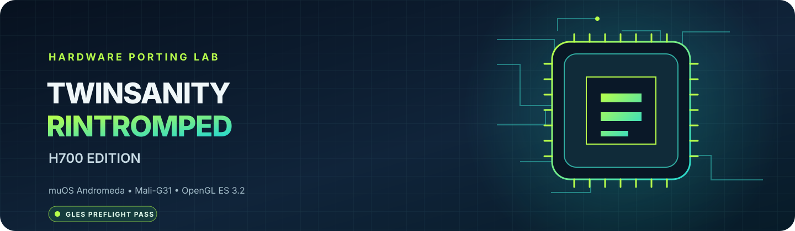

# Graphics port

**From the confirmed muOS SDL/Mali path to the first NativeEE-rendered frame.**

> [!NOTE]
> The physical H700 has passed EGL 1.4, OpenGL ES 3.2, GLSL ES 3.20 and SDL window presentation. The engine's full rendering path is a separate validation gate.

## 🧭 Runtime architecture

~~~mermaid
flowchart TD
    A["muOS Andromeda"] --> B["SDL2 · mali video driver"]
    B --> C["EGL 1.4"]
    C --> D["OpenGL ES 3.2 · GLSL ES 3.20"]
    D --> E["NativeEE GLES adapter"]
    E --> F["GS textures · FBO · depth/stencil"]
    F --> G["SDL buffer swap"]
~~~

The first three graphics layers are confirmed on the physical device. NativeEE integration, GS surfaces and game output remain under development.

## ✅ Physical device evidence

| Layer | Result |
|---|---|
| EGL | 1.4 · ARM · Bifrost r20p0 |
| GPU | Mali-G31 |
| GLES / GLSL | 3.2 / 3.20 |
| SDL video backend | `mali` |
| Window and context | Created successfully |
| Presentation | Six visible solid-colour frames |
| Display mode | 640×480p-59 |

See the [device profile](device-profile.md) for the full environment and extension inventory.

## 🧪 First full-runner attempt · 13 November 2026

The first physical launch of the full NativeEE runner passed the launcher-to-runner hand-off and reached game initialisation:

- The runner received `--iso` with the expected `game.iso` path.
- The disc detector identified the supplied PAL image as `SLES-52568`; the retail ELF was loaded.
- muOS gamepad input and the SDL audio device initialised.
- SDL created an OpenGL ES 3.2 context on the Mali-G31.

The first production PS2 vertex shader then failed on Mali because the embedded raw-string source had a leading newline before `#version`. Mesa had accepted that source layout, while the Mali compiler correctly required `#version` on the first line. The GLES converter now removes leading whitespace, verifies that `#version` is first, and only then rewrites the source to GLSL ES 3.20. The production shader smoke passes on Mesa after this change; a fresh run on the physical Mali driver is still required.

The same log exposed a separate first-run storage issue: `userdata/` was selected before it existed, so writing `ps2r.ini.tmp` failed. The runner now creates and write-probes its data directory, with a fallback to the per-user data path. Host regression tests cover both a missing directory and an unusable preferred path.

**What this proves:** the real runner, disc loader, input/audio initialisation and Mali context are now reached. **What it does not prove:** a successful Mali shader compile, a visible NativeEE frame, a title screen or playable gameplay.

## 🧩 Compatibility work in the engine

| Desktop assumption | H700 adaptation | Evidence state |
|---|---|---|
| `GL/glcorearb.h` | `GLES3/gl32.h` selected by `PS2R_USE_GLES` | Source added |
| OpenGL 4.1 core | SDL requests ES 3.2 and verifies the returned version | Physical SDL path passes |
| GLSL 4.10 core | Runtime conversion to GLSL ES 3.20 with highp defaults | Source guard added; device shader test pending |
| `noperspective` varying | Removed only for the audited `v_texcoord` path | Mathematical rationale; image comparison pending |
| `glProgramUniform*` | Bind target program, update with `glUniform*`, restore previous program | Compile/runtime test pending |
| `glClearDepth` | `glClearDepthf` | Compile gate |
| `glGetTexLevelParameteriv` | Derive mip dimensions from surface dimensions and level | Compile gate; mip capture pending |
| `glDrawBuffer(GL_NONE)` | `glDrawBuffers(1, { GL_NONE })` | Compile gate; FBO test pending |
| `GL_MAP_UNSYNCHRONIZED_BIT` | Omit desktop-only flag; retain GLES write/flush flags | Compile gate; streaming stress pending |
| Desktop timer queries | Disabled in first GLES profile | Deliberate fallback |

## 🧪 Validation sequence

~~~mermaid
flowchart LR
    A["Compile GLES backend"] --> B["Compile/link production shaders"]
    B --> C["Test FBO + depth/stencil"]
    C --> D["Texture + mip + readback"]
    D --> E["Compare deterministic images"]
    E --> F["Present first NativeEE frame"]
~~~

Each gate needs its own evidence. A compile pass cannot substitute for shader execution, and shader execution cannot substitute for a correct rendered image.

## ⚙️ Shader conversion policy

The shared shader catalogue stays in desktop GLSL form. The H700 profile converts each shader immediately before compilation:

1. Require the audited `#version 410 core` source profile.
2. Replace it with `#version 320 es`.
3. Insert default `highp` precision declarations for float and int.
4. Remove `noperspective` only from the audited `v_texcoord` varying.

The PS2 vertex path sets `gl_Position.w = 1.0`, so smooth interpolation is screen-linear for this particular varying. This is a narrow source-level equivalence argument, not a global permission to remove interpolation qualifiers. The final proof is a deterministic image comparison on the actual renderer.

## 🔬 Known engineering risks

Uniform update cost

GLES 3.2 has no core `glProgramUniform*` family. The initial adapter temporarily binds the destination program and uses `glUniform*`. This favors correctness over throughput. Once shader and draw correctness are proven, updates should be batched while the intended program is already bound, with state-cache tests.

Buffer streaming and synchronization

The tested Mali driver advertises `GL_OES_mapbuffer` and `GL_EXT_buffer_storage`. The initial path uses GLES core map flags and does not claim unsynchronized access. Measure write visibility, stalls and frame pacing before introducing an extension-specific ring.

Framebuffer, texture and readback behavior

The engine must validate every color/depth/stencil attachment combination, mip allocation, texture upload format, row alignment and readback path. Extension presence alone does not prove that a particular format is renderable.

GPU timing

The device advertises `GL_EXT_disjoint_timer_query`. The desktop query implementation is disabled until a GLES-specific adapter handles the extension entry points and disjoint state correctly.

## 🎯 First-frame acceptance criteria

- [ ] All selected renderer and SDL translation units compile for AArch64 against GLES 3.2 headers.
- [ ] The actual NativeEE shader library compiles and links every production shader on the Mali-G31.
- [ ] Framebuffer, depth/stencil and texture tests pass on the device.
- [ ] Deterministic output matches the agreed desktop reference.
- [ ] A frame rendered by NativeEE—not a standalone SDL test—is visible on the panel.
- [ ] Desktop, Windows and Vita CI remain green.

> [!WARNING]
> **MUST KNOW!!** The current H700 build is not playable. The diagnostic probes do not load `game.iso`, execute the game renderer or validate gameplay.

[Back to the H700 hub](README.md) · [Compatibility matrix](compatibility-matrix.md) · [Roadmap](roadmap.md)
