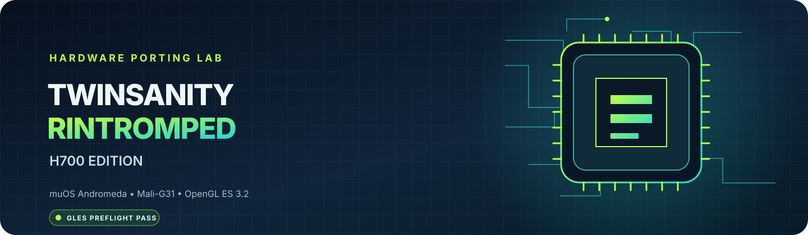

# Graphics port

**From the confirmed muOS SDL/Mali path to the first NativeEE-rendered frame.**

> [!NOTE]
> The physical H700 has passed EGL/GLES/SDL preflight, and a later PAL runner reached the beach hub on an earlier package. That proves a rendered NativeEE scene, but the run ended in OOM; the current package and full rendering path still need a fresh device test.

## 🧭 Runtime architecture

~~~mermaid
flowchart TD
    A["muOS Andromeda"] --> B["SDL2 · mali video driver"]
    B --> C["EGL 1.4"]
    C --> D["OpenGL ES 3.2 · GLSL ES 3.20"]
    D --> E["NativeEE GLES adapter"]
    E --> F["GS textures · FBO · depth/stencil"]
    F --> G["SDL buffer swap"]
~~~

The first three graphics layers are confirmed on the physical device. NativeEE integration, GS surfaces and game output remain under development.

## ✅ Physical device evidence

| Layer | Result |
|---|---|
| EGL | 1.4 · ARM · Bifrost r20p0 |
| GPU | Mali-G31 |
| GLES / GLSL | 3.2 / 3.20 |
| SDL video backend | `mali` |
| Window and context | Created successfully |
| Presentation | Six visible solid-colour frames |
| Display mode | 640×480p-59 |

See the [device profile](device-profile.md) for the full environment and extension inventory.

## 🧪 First full-runner attempt · 13 November 2026

The first physical launch of the full NativeEE runner passed the launcher-to-runner hand-off and reached game initialisation:

- The runner received `--iso` with the expected `game.iso` path.
- The disc detector identified the supplied PAL image as `SLES-52568`; the retail ELF was loaded.
- muOS gamepad input and the SDL audio device initialised.
- SDL created an OpenGL ES 3.2 context on the Mali-G31.

The first production PS2 vertex shader then failed on Mali because the embedded raw-string source had a leading newline before `#version`. Mesa had accepted that source layout, while the Mali compiler correctly required `#version` on the first line. The GLES converter now removes leading whitespace, verifies that `#version` is first, and only then rewrites the source to GLSL ES 3.20. The production shader smoke passes on Mesa after this change; a fresh run on the physical Mali driver is still required.

The same log exposed a separate first-run storage issue: `userdata/` was selected before it existed, so writing `ps2r.ini.tmp` failed. The runner now creates and write-probes its data directory, with a fallback to the per-user data path. Host regression tests cover both a missing directory and an unusable preferred path.

**What this proves:** the real runner, disc loader, input/audio initialisation and Mali context are now reached. **What it does not prove:** a successful Mali shader compile, a visible NativeEE frame, a title screen or playable gameplay.

## 🧪 Later physical PAL run — beach hub reached, then OOM

A later H700/Mali-G31 report records the supplied PAL image reaching `levels/earth/hub/beach`. This is evidence that a NativeEE-rendered game scene was presented on an earlier package, beyond the six-colour SDL preflight. The Linux OOM killer subsequently terminated `te-game` at approximately 706 MiB file-backed RSS plus 127 MiB anonymous RSS.

The report does not include the exact muOS build, source SHA or package digest, so this result cannot be assigned to the current CI artifact. The current 0.2.5-dev candidate adds first-draw texture decoding, lower retained texture-pool budgets and RSS telemetry. A fresh physical run must confirm whether those changes prevent the same OOM. The scene render is a historical first-frame milestone, not proof of sustained gameplay, correct full-scene output, stable memory, controls, audio/video or disc streaming.

## 🧩 Compatibility work in the engine

| Desktop assumption | H700 adaptation | Evidence state |
|---|---|---|
| `GL/glcorearb.h` | `GLES3/gl32.h` selected by `PS2R_USE_GLES` | Source added |
| OpenGL 4.1 core | SDL requests ES 3.2 and verifies the returned version | Physical SDL path passes |
| GLSL 4.10 core | Runtime conversion to GLSL ES 3.20 with highp defaults | Source guard added; device shader test pending |
| `noperspective` varying | Removed only for the audited `v_texcoord` path | Mathematical rationale; image comparison pending |
| `glProgramUniform*` | Queue changed values, bind the selected PS2 program once, flush dirty values with `glUniform*` | AArch64 compile gate; Mali frame timing pending |
| `glClearDepth` | `glClearDepthf` | Compile gate |
| `glGetTexLevelParameteriv` | Derive mip dimensions from surface dimensions and level | Compile gate; mip capture pending |
| `glDrawBuffer(GL_NONE)` | `glDrawBuffers(1, { GL_NONE })` | Compile gate; FBO test pending |
| `GL_MAP_UNSYNCHRONIZED_BIT` | Omit desktop-only flag; retain GLES write/flush flags | Compile gate; streaming stress pending |
| Desktop timer queries | Disabled in first GLES profile | Deliberate fallback |

## 🧪 Validation sequence

~~~mermaid
flowchart LR
    A["Compile GLES backend"] --> B["Compile/link production shaders"]
    B --> C["Test FBO + depth/stencil"]
    C --> D["Texture + mip + readback"]
    D --> E["Compare deterministic images"]
    E --> F["Present first NativeEE frame"]
~~~

Each gate needs its own evidence. A compile pass cannot substitute for shader execution, and shader execution cannot substitute for a correct rendered image.

## ⚙️ Shader conversion policy

The shared shader catalogue stays in desktop GLSL form. The H700 profile converts each shader immediately before compilation:

1. Require the audited `#version 410 core` source profile.
2. Replace it with `#version 320 es`.
3. Insert default `highp` precision declarations for float and int.
4. Remove `noperspective` only from the audited `v_texcoord` varying.

The PS2 vertex path sets `gl_Position.w = 1.0`, so smooth interpolation is screen-linear for this particular varying. This is a narrow source-level equivalence argument, not a global permission to remove interpolation qualifiers. The final proof is a deterministic image comparison on the actual renderer.

## 🔬 Known engineering risks

Uniform update cost · batched on H700

The H700 path queues scalar and small vec4-array changes in the uniform shadow. After the draw variant is selected, it binds that PS2 program once and flushes only that program's dirty values through `glUniform*`. This avoids the per-uniform `glGetIntegerv(GL_CURRENT_PROGRAM)` plus bind/restore sequence in the normal GLES draw path. Oversized/untracked arrays and the opt-out path retain the conservative immediate uploader.

Set `TE_GFX_UNIFORM_SYNC=0` before launching the runner to restore immediate uploads for an A/B comparison. This is a CPU/driver-call reduction hypothesis, not a measured frame-rate improvement: compare profiler output on the physical Mali-G31 before making further claims.

Buffer streaming and synchronization

The tested Mali driver advertises `GL_OES_mapbuffer` and `GL_EXT_buffer_storage`. The initial path uses GLES core map flags and does not claim unsynchronized access. Measure write visibility, stalls and frame pacing before introducing an extension-specific ring.

Framebuffer, texture and readback behavior

The engine must validate every color/depth/stencil attachment combination, mip allocation, texture upload format, row alignment and readback path. Extension presence alone does not prove that a particular format is renderable.

GPU timing

The device advertises `GL_EXT_disjoint_timer_query`. The desktop query implementation is disabled until a GLES-specific adapter handles the extension entry points and disjoint state correctly.

## 🎯 First-frame acceptance criteria

- [ ] All selected renderer and SDL translation units compile for AArch64 against GLES 3.2 headers.
- [ ] The actual NativeEE shader library compiles and links every production shader on the Mali-G31.
- [ ] Framebuffer, depth/stencil and texture tests pass on the device.
- [ ] Deterministic output matches the agreed desktop reference.
- [ ] A frame rendered by NativeEE—not a standalone SDL test—is visible on the panel.
- [ ] Desktop, Windows and Vita CI remain green.

> [!WARNING]
> **MUST KNOW!!** The current H700 build is not playable. The diagnostic probes do not load `game.iso`, execute the game renderer or validate gameplay.

[Back to the H700 hub](README.md) · [Compatibility matrix](compatibility-matrix.md) · [Roadmap](roadmap.md)

## H700 startup UI status and performance profile

The SDL/ImGui settings screen in `engine/app/host/launcher.cpp` exists in the NativeEE host library, but it is **not part of the executable currently shipped in the full H700 .muxapp**. The package's `twinsanityevolved` binary is built from `runner/main.cpp`; that runner has its own command-line parser and does not accept `--launcher`. The earlier muOS wrapper revision passed that unsupported flag and caused the runner to print Usage() and exit before starting the game.

The muOS hand-off is now deliberately limited to the runner's supported `--iso <image>` form. The `launcher.show` value in `userdata/ps2r.ini` is currently ignored by this standalone runner. The startup menu, animated menu background, and its settings controls are **not yet shipped in the H700 package**; they must be integrated into the actual runner target before being advertised as available on-device.

The display profile code in the NativeEE host settings screen is likewise not evidence that the separate runner is applying those settings. The runner's live log reports the effective values (for example, `frame rate 60`); use those runtime lines rather than the unlinked settings screen when checking the device configuration. A 30-rate presentation target, where supported by the runner, changes display cadence rather than underclocking the EE/game simulation or the physical Cortex-A53.

## H700 runtime batching and performance diagnostics

The GLES uniform uploader is deferred by default on H700. For a controlled A/B run, set `TE_GFX_UNIFORM_SYNC=0` in the launch environment before starting the app; do not compare runs with different scene/load conditions.

The H700 GLES profile enables two conservative batching paths by default: adjacent blended draws with identical fixed-function state are joined in order, and consecutive shadow-volume count draws are grouped by stencil state. The environment overrides `TE_GFX_JOIN_BLENDED=0` and `TE_GFX_GROUP_VOLUMES=0` remain available for A/B comparison. These changes do not alter the title simulation rate or the internal render scale.

The full H700 package includes `logs/performance-diagnostics.once`, so the first launch after installing an update automatically runs the NativeEE CPU sampler at 2 ms intervals plus the frame/build/render census every 120 presents. The marker is removed before the game starts; normal subsequent launches do not run the sampler. To collect another report later, recreate the empty marker file. Reports are appended to `logs/game-launch.log`.

## Texture-pool fence safety

The GLES texture pool may refill an existing allocation with `glTexSubImage2D` only after a sync object was successfully created and `glClientWaitSync` reports it signalled. A null result from `glFenceSync` is **not** evidence that the GPU is idle: the entry remains busy and the caller re-specifies it with `glTexImage2D`, allowing OpenGL to preserve any in-flight storage. A pending or failed fence poll follows the same conservative path. The Vita profile does not use sync objects for this pool and therefore also re-specifies retired storage.

The host regression `Render_TexturePoolFenceSafety` checks that only the `Signaled` state permits in-place refill. This protects the fallback decision in code; it does not measure Mali memory pressure or replace the fresh physical OOM-retest required by the H700 acceptance plan.
