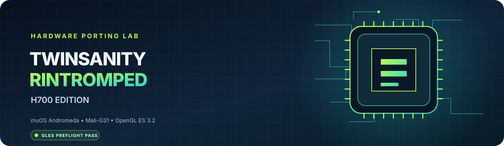

# Porting roadmap

**A staged route from proven hardware access to a stable, reproducible handheld release.**

> [!IMPORTANT]
> Each milestone has an evidence gate. A green compile job does not imply that shaders, images or gameplay work on the device.

## 🧭 Milestone map

~~~mermaid
flowchart TD
    A["1 · Hardware preflight"] --> B["2 · GLES compile + link"]
    B --> C["3 · Production shader tests"]
    C --> D["4 · GS surfaces + image validation"]
    D --> E["5 · First NativeEE frame"]
    E --> F["6 · Game boot + title"]
    F --> G["7 · Input · audio · disc · saves"]
    G --> H["8 · Performance · packaging · release"]
~~~

## 📍 Current progress

## 🧪 Physical full-runner bring-up — 13 November 2026

An earlier full runner was installed and launched on a physical H700/Mali-G31 using the user's own disc image. The launcher passed `--iso`; NativeEE identified the PAL `SLES-52568` image, loaded the retail ELF, initialised the muOS gamepad and SDL audio, and created an ES 3.2 context. The first PS2 vertex shader then failed because the raw GLSL source contained a leading newline before `#version`. The GLES source normaliser was subsequently fixed and its production shader library now passes the blocking Mesa GLES smoke. A separate first-run `userdata/` creation bug was fixed and covered by host regression tests.

The 13 November report does not record an exact firmware build, package SHA-256 or Actions artifact for that physical runner; do not attach the later CI package hash to this older test.

**Milestone boundary:** physical runner startup and disc/retail-ELF initialisation were demonstrated, but the first NativeEE-rendered frame, title screen and gameplay were **not**. The shader normaliser fix has not yet been retested on the physical Mali device.

## ✅ CI evidence — 16 November 2026

Exact code HEAD `681f0b3249cbb4e3f900ff55db4db252c949e3e3`, H700 run [#310](https://github.com/SilverCrow2323/Twinsanity-Rintromped-H700-Edition/actions/runs/43844953315), passed all six jobs: host checks, GLES renderer compile, blocking Mesa production-shader smoke, full AArch64 runner link, diagnostic package and full muOS muxapp package.

The full runner is ELF64 little-endian AArch64 PIE and requires symbols up to `GLIBC_2.30`, within the pinned Bullseye GLIBC 2.31 baseline. FFmpeg 6.1.2's minimal MPEG-1/2 decoder + parser + swscale subset is statically linked with the LGPL recipe.

The full runner-candidate `.muxapp` was downloaded and inspected: valid ZIP, exact `TwinsanityRintromped/` root, launcher/language files, diagnostics, runtime and licence payload. Inner package SHA-256:

```text
f243a70cd66cdcab65f2cbc1dd8f1750536bbb21dfb31a4c388ef35369b54e53
```

Actions artifact ID `14214608053`; outer ZIP digest `3a53eed01fd3e43583bb13b3758aafd48b5800ce1fecc61c32b01353d5b5d8e9`.

**Critical build boundary:** this CI run had no title ELF or disc image. Title-specific recompilation, game composition and title-dependent EE/CDVD tests were skipped. The linked NativeEE runner and complete package are not proof of a playable game or first frame. The Mesa shader smoke validates compile/link on llvmpipe only, not Mali rendering.

| Stage | Exit criteria | State |
|---|---|---|
| 1 · Hardware preflight | EGL 1.4, GLES 3.2, SDL Mali window and visible swaps | **Passed on physical H700** |
| 2 · GLES compile + link | Renderer and SDL source objects cross-compile for AArch64; NativeEE runner links against ARM64 GLES and static LGPL FFmpeg | **Passed in CI** (`681f0b32`) |
| 3 · Production shaders | Required NativeEE programs compile/link in Mesa and on Mali-G31 | **Mesa CI passed** (`681f0b32`); physical Mali retest pending |
| 4 · GS surfaces | FBO, depth/stencil, textures, mipmaps and readback validated | Pending |
| 5 · First engine frame | NativeEE presents a deterministic renderer-generated frame | Pending |
| 6 · Game boot | Game reaches title and first interactive scene | Pending |
| 7 · Runtime systems | Controls, audio, ISO streaming, saves and clean exit | Pending |
| 8 · Release | Stable frame pacing, thermals, install/update and docs | **Runner candidate packaged**; title-specific build and physical validation pending |

## 1 — Hardware preflight · PASSED

- EGL 1.4 and GLES 3.2 initialise on the tested H700.
- SDL selects the `mali` video backend.
- A real SDL window creates an ES 3.2 context and presents six visible colour frames.
- Device profile and extension list are recorded in the engineering docs.

## 2 — GLES compile and link

- [x] Cross-compile the selected real NativeEE renderer and SDL source units for AArch64 against ARM64 GLES/SDL headers.
- [x] Build and link the NativeEE shader diagnostic executable against the ARM64 EGL/GLES sysroot.
- [x] Keep desktop, Windows and Vita paths covered by their separate build workflows.
- [x] Link the NativeEE AArch64 runner candidate against the Bullseye-compatible sysroot; CI checks the GLIBC 2.31 baseline (runner requires up to GLIBC 2.30). The latest run had no title ELF/disc input, so title-specific recompilation and game composition were skipped.
- [x] Build pinned FFmpeg 6.1.2 for AArch64 with the minimal static LGPL MPEG-1/2 + parser + swscale recipe.
- [x] Verify no dynamic FFmpeg libraries remain in the runner and retain the FFmpeg licence/build proof in the app archive.
- [x] Package the NativeEE runner candidate and three hardware diagnostics into a ZIP-based muOS `.muxapp`; verify root layout, executable modes, archive integrity and absence of user disc data.
- [x] Make renderer compile, Mesa shader smoke, full AArch64 link and full package gates blocking in CI.
- [ ] Run the packaged production shader smoke on the physical Mali-G31 and inspect its report.
- [ ] Retest the packaged runner on Mali after the shader normaliser fix; reach the first NativeEE frame, then validate title screen, controls, audio, streaming, saves and clean exit.

## 3–4 — Production shaders and GS surfaces

- [x] Execute the real `GlShaderLibrary::Build()` under Mesa GLES 3.2 in blocking CI.
- [x] Package the same NativeEE shader smoke as an AArch64 executable in the muOS diagnostic `.muxapp`.
- [ ] Execute the packaged `GlShaderLibrary::Build()` on the Mali-G31 and inspect `logs/gles-shader-report.txt`.
- [ ] Confirm every required shader program on the device and resolve any Mali-specific compiler differences.
- [ ] Test color, depth and stencil FBO combinations.
- [ ] Test texture uploads, mip tails, filtering and supported formats.
- [ ] Test copies, readback alignment and synchronization.
- [ ] Capture deterministic images and compare them against desktop references.

## 5 — First NativeEE frame

- [ ] Initialise the renderer through the actual engine composition root.
- [ ] Draw a small deterministic scene using production buffers, shaders and render targets.
- [ ] Present through the normal SDL application path.
- [ ] Record GPU/API, shader results, frame time and memory footprint.
- [ ] Validate the captured image before moving to game boot.

## 6–8 — Game runtime and release candidate

The NativeEE runner-candidate `.muxapp` now exists as a reproducible CI artifact. It is not game-verified: the latest CI build had no title ELF/disc input, and title-specific recompilation and game composition were skipped. The next test is on the physical H700: install this exact package, retest production shaders on Mali after the normaliser fix, record the first NativeEE frame, then verify the game's title screen and an interactive scene.

The final stable-release gate still includes repeatable cold boot, correct rendering, controller mapping, audio, disc streaming, save/load, clean shutdown, stable frame pacing/thermals, upgrade-safe muOS packaging, user-data preservation, clear troubleshooting guides and a reproducible CI artifact.

## Definition of done

A playable H700 release must repeatedly boot the user's own game image, render representative scenes correctly, accept controls, play audio, stream disc data, save/load, exit cleanly and sustain an agreed performance/thermal target. Every claim must be backed by physical-device evidence.

[Back to the H700 hub](README.md) · [Graphics port](graphics-port.md) · [Build guide](building.md)
